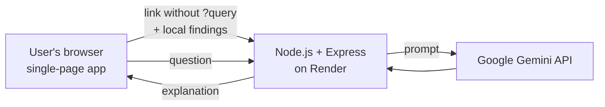

# TrustLens

**Know before you click.** TrustLens checks a link for phishing warning signs, explains the result in plain language with AI, and has a built-in security assistant for questions like "I entered my password on a fake page, what now?"

Built for **HackMatrix '26** (Adamas University) - problem statement: an accessible platform that detects phishing and malicious websites.

| | |
|---|---|
| **Live app** | https://trustlens-xoqm.onrender.com |
| **Demo video** |  |
| **Source code** | https://github.com/agniveshchatterjee08/TrustLens |

> The app runs on a free hosting plan. If nobody has used it for a while, the **first load can take up to a minute** while the server wakes up.

---

## What TrustLens does

1. You paste a link into the glowing box and press **SCAN**.
2. The page instantly scores it from 0 to 100 using explainable rules, and shows every alert with the points it added.
3. If "AI explanation" is on, a Google Gemini model explains the evidence in plain words and suggests one safe action.
4. The corner chat bubble answers general security questions (what to do after a risky click, how to spot scams).

TrustLens **never opens or visits** the link you submit. It analyses the link text only.

## How it covers the problem statement (honest status)

| Pillar in the problem statement | Status | What we built / what is missing |
|---|---|---|
| Intelligent threat analysis | **Built** | Rule-based URL analysis plus an AI explanation (details below) |
| Accessible platform | **Built** | Works in any browser, plain-language results, no sign-up, works on phones |
| Web security assessment | **Not built** | We chose **not** to probe or scan websites we do not own (legal and ethical risk). Planned: passive checks of security headers (HSTS, CSP) |
| Certificate validation | **Not built** | Planned, see roadmap. The only related signal today is flagging `http://` (unencrypted) links |
| Collaborative threat intelligence | **Not built** | Planned, see roadmap |

We would rather show what truly works than claim everything.

## Detection rules

Each rule adds points. The total (capped at 100) decides the verdict: **0-29 Low risk**, **30-59 Suspicious**, **60-100 High risk**. We never say "safe", because a link's text alone cannot prove that.

| Signal | Points |
|---|---|
| Script or data link (`javascript:`, `data:`) | 100 |
| Look-alike of a known brand (e.g. `paypa1.com`) | +60 |
| Mentions a known brand but is not its real domain (e.g. `sbi-secure-login.xyz`) | +40 |
| Raw IP address instead of a website name | +30 |
| `@` sign inside the link | +25 |
| Look-alike letters (`xn--` punycode) | +25 |
| Not encrypted (`http://`) | +15 |
| Many subdomains (4 or more dots) | +15 |
| Link shortener (hides the destination) | +15 |
| Another link hidden inside the link (redirect) | +15 |
| Pressure words in the site name (login, verify, secure, update, account, wallet, kyc, otp) | +10 each, max +30 |
| Cheap, often-abused ending (.xyz, .top, .click, .tk and similar) | +10 |
| Very long link (over 75 characters) | +10 |
| Three or more hyphens in the site name | +10 |

The brand list covers 20 popular Indian and global brands (banks, payment apps, government and university sites, big tech). It is easy to extend (see `BRANDS` in `public/index.html`).

### Example results from our testing

| Link (typed, never opened) | Result |
|---|---|
| `https://www.wikipedia.org` | Low risk, 0 |
| `https://www.hdfcbank.com` | Low risk, 0 (real bank domain is not flagged) |
| `http://192.168.1.1/login` | Suspicious, 45 |
| `http://account-verify-update.top/login` | Suspicious, 55 |
| `https://sbi-secure-login.xyz` | High risk, 70 |
| `https://paytm.com.verify-now.xyz` | High risk, 60 |
| `https://paypa1.com` | High risk, 60 |

## Architecture



- **Frontend:** one file, `public/index.html` (HTML, CSS and JavaScript). The scoring rules run **in the browser**, so the local result appears instantly and works even if the AI is unavailable.
- **Backend:** `server.js` (Node.js 20+, Express 5). It has two endpoints, `POST /api/analyze` and `POST /api/chat`, which call Gemini from the server so the API key is never exposed to the browser. `GET /health` is a simple "is the server awake" check.
- **Optional extension:** see below.

## Privacy and security

- The link is analysed as **text only**. We never visit it.
- With "AI explanation" on, **only the link without anything after `?` or `#`** is sent to our server and then to Google Gemini. Turn the checkbox off to keep everything in your browser.
- Our code has **no database** and does not store submitted links.
- The API key lives only in the server's environment settings. `.env` is excluded by `.gitignore` and is never in this repository.
- Server protections: input validation and size limits, rate limiting (20 requests per minute per visitor), security headers (Helmet), and CORS configuration.
- The page shows all server and user-provided text with `textContent`, never as HTML, to prevent script injection.
- We do **not** scan, probe or attack other websites.

## Run it locally

You need Node.js 20 or newer and a Gemini API key from https://aistudio.google.com/apikey.

```bash
git clone https://github.com/agniveshchatterjee08/TrustLens.git
cd TrustLens
npm install
```

Create a file named `.env` in the project folder (never commit it):

```env
GEMINI_API_KEY=your-key-here
GEMINI_MODEL=gemini-flash-latest
PORT=3000
```

Then start it and open http://localhost:3000:

```bash
npm start
```

Without a key the scanner still works; only the AI explanation and chat show a "not configured" message.

## Deploy (Render, free plan)

1. Create a **Web Service** from this public repository.
2. Build command: `npm install`. Start command: `npm start`. Instance type: Free.
3. Add environment variables `GEMINI_API_KEY`, `GEMINI_MODEL` (`gemini-flash-latest`) and optionally `ALLOWED_ORIGIN`.
4. After every code change, push to GitHub and press **Manual Deploy > Deploy latest commit** on Render.

## Firefox extension (prototype)

The `extension/` folder contains a tiny Firefox add-on. Click its toolbar button on any website and it opens TrustLens with that page's address already filled in and scanned. It sends only the site and path, never the `?query` or `#fragment`.

1. Open Firefox and go to `about:debugging`, then **This Firefox**.
2. Click **Load Temporary Add-on** and choose `extension/manifest.json`.
3. In `extension/background.js`, `TRUSTLENS_URL` must point at the live app.

Firefox removes temporary add-ons when it closes, so load it again after a restart.

## Limitations (please read)

- This is a **heuristic** tool. It combines several weak signals into one score. It is **not** a guarantee: a brand-new, clean-looking fake site can score 0, and an unusual but harmless link can score higher than it deserves.
- Because the link is analysed as text only, TrustLens cannot see page content, certificates, domain age, or whether a site is on a threat list.
- The brand list covers 20 brands; unlisted brands are only caught by the generic rules.
- We have **not** measured detection accuracy on a labelled dataset, so we make no accuracy claims.
- The AI can be slow or temporarily busy (high demand on Google's side). The local result is always shown first and stays valid.
- Free hosting means a slow first load after idle time.

## Roadmap

1. **Certificate validation:** read the certificate chain and flag weak or suspicious keys, very new certificates and unexpected issuers. This is motivated by the recent eMudhra TLS incident, where weak key generation affected certificate authorities.
2. **Certificate Transparency monitoring:** watch for newly issued certificates on look-alike domains of popular brands.
3. **Passive web security assessment:** report missing security headers (HSTS, CSP, cookie flags) from a single normal request, never active scanning.
4. **Collaborative threat intelligence:** community reports with reputation-weighted voting and an automatic check before anything is published.
5. **Richer extension:** show the verdict inside the browser, and use Firefox's certificate API for the certificate checks above.
6. **Domain age and reputation feeds** as extra signals.

## Tech stack

Node.js 20+, Express 5, Helmet, express-rate-limit, `@google/genai` (Gemini), plain HTML/CSS/JavaScript, hosted on Render. AI-assisted coding (Claude and Gemini) was used during development; the team tested and deployed the result.

## Team

| Name | Role |
|---|---|
| Agnivesh | Repository, web page, README, api integration |
| samridhya | backend , deployment  |
| Ankit | using corn job to kep the website running , live video recording  |
| Subham | video edit |
