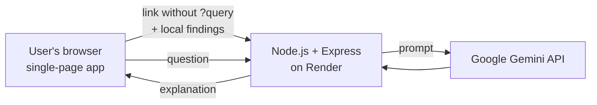

# TrustLens

**Know before you click.** Built for **HackMatrix '26** (Adamas University) by Team Code Reapers.

---

## 1. Project name and one-line description

**TrustLens** checks a link for phishing warning signs, explains the result in plain language with AI, and includes a security assistant for questions like "I entered my password on a fake page, what now?"

Team: Agnivesh (repository, web page, README, API integration), Samridhya (backend, deployment), Ankit (cron job to keep the site awake, live video recording), Subham (video editing).

## 2. Problem

Phishing and malicious websites are one of the most common ways people lose money and accounts. Most people cannot tell a fake link from a real one, and most tools only say "dangerous" or "safe" with no reason, so the user learns nothing.

The HackMatrix problem statement asks for an accessible platform that detects phishing and malicious websites and explains the risk to ordinary users. The challenge is to do this clearly, honestly, and without needing a security background.

## 3. Solution

1. You paste a link into the box and press **SCAN**.
2. The page instantly scores it from 0 to 100 using explainable rules, and lists every alert with the points it added.
3. If "AI explanation" is on, a Google Gemini model explains the evidence in plain words and suggests one safe action.
4. The corner chat bubble answers general security questions (what to do after a risky click, how to spot scams).

TrustLens **never opens or visits** the link you submit. It analyses the link text only.

### Honest status against the problem statement

| Pillar | Status | Notes |
|---|---|---|
| Intelligent threat analysis | **Built** | Rule-based URL analysis plus an AI explanation |
| Accessible platform | **Built** | Works in any browser, plain-language results, no sign-up, works on phones |
| Web security assessment | **Not built** | We chose not to probe websites we do not own (legal and ethical risk). Planned: passive checks of security headers (HSTS, CSP) |
| Certificate validation | **Not built** | Planned. The only related signal today is flagging `http://` (unencrypted) links |
| Collaborative threat intelligence | **Not built** | Planned |

### Detection rules

Each rule adds points. The total (capped at 100) decides the verdict: **0-29 Low risk**, **30-59 Suspicious**, **60-100 High risk**. We never say "safe", because a link's text alone cannot prove that.

| Signal | Points |
|---|---|
| Script or data link (`javascript:`, `data:`) | 100 |
| Look-alike of a known brand (e.g. `paypa1.com`) | +60 |
| Mentions a known brand but is not its real domain (e.g. `sbi-secure-login.xyz`) | +40 |
| Raw IP address instead of a website name | +30 |
| `@` sign inside the link | +25 |
| Look-alike letters (`xn--` punycode) | +25 |
| Not encrypted (`http://`) | +15 |
| Many subdomains (4 or more dots) | +15 |
| Link shortener (hides the destination) | +15 |
| Another link hidden inside the link (redirect) | +15 |
| Pressure words in the site name (login, verify, secure, update, account, wallet, kyc, otp) | +10 each, max +30 |
| Cheap, often-abused ending (.xyz, .top, .click, .tk and similar) | +10 |
| Very long link (over 75 characters) | +10 |
| Three or more hyphens in the site name | +10 |

The brand list covers 20 popular Indian and global brands. It is easy to extend (see `BRANDS` in `public/index.html`).

### Example results from our testing

| Link (typed, never opened) | Result |
|---|---|
| `https://www.wikipedia.org` | Low risk, 0 |
| `https://www.hdfcbank.com` | Low risk, 0 (real bank domain is not flagged) |
| `http://192.168.1.1/login` | Suspicious, 45 |
| `http://account-verify-update.top/login` | Suspicious, 55 |
| `https://sbi-secure-login.xyz` | High risk, 70 |
| `https://paytm.com.verify-now.xyz` | High risk, 60 |
| `https://paypa1.com` | High risk, 60 |

### Privacy and security

- The link is analysed as **text only**. We never visit it.
- With "AI explanation" on, only the link **without anything after `?` or `#`** is sent to our server and then to Google Gemini. Turn the checkbox off to keep everything in your browser.
- No database. Submitted links are not stored.
- The API key lives only in the server's environment settings. `.env` is excluded by `.gitignore` and is not in this repository.
- Server protections: input validation and size limits, rate limiting (20 requests per minute per visitor), security headers (Helmet), CORS configuration.
- Page text is shown with `textContent`, never as HTML, to prevent script injection.
- We do **not** scan, probe or attack other websites.

### Limitations

- This is a **heuristic** tool. It combines several weak signals into one score. A brand-new, clean-looking fake site can score 0, and an unusual but harmless link can score higher than it deserves.
- Because the link is analysed as text only, TrustLens cannot see page content, certificates, domain age, or whether a site is on a threat list.
- The brand list covers 20 brands. Unlisted brands are only caught by the generic rules.
- We have **not** measured detection accuracy on a labelled dataset, so we make no accuracy claims.
- The AI can be slow or temporarily busy. The local result is always shown first and stays valid.
- Free hosting means a slow first load (up to a minute) after idle time.

### Roadmap

1. Certificate validation (chain, weak keys, very new certificates, unexpected issuers).
2. Certificate Transparency monitoring for look-alike domains of popular brands.
3. Passive security header assessment (HSTS, CSP, cookie flags) from one normal request, never active scanning.
4. Collaborative threat intelligence with reputation-weighted community reports.
5. Richer browser extension that shows the verdict inside the browser.
6. Domain age and reputation feeds as extra signals.

## 4. Demo links and a screenshot

| | |
|---|---|
| **Live app** | https://trustlens-xoqm.onrender.com |
| **Demo video** |https://youtu.be/1O9EZTOwt_Y?si=2kL9ZUn0tdtChGG3 |
| **Source code** | https://github.com/agniveshchatterjee08/TrustLens |

> The app runs on a free hosting plan. If nobody has used it for a while, the first load can take up to a minute while the server wakes up.


## 5. Tech stack

- **Frontend:** plain HTML, CSS and JavaScript in one file, `public/index.html`
- **Backend:** Node.js 20+, Express 5
- **Security middleware:** Helmet, express-rate-limit
- **AI:** Google Gemini through `@google/genai`
- **Hosting:** Render (free plan)
- **Prototype extension:** Firefox add-on (`extension/`)

## 6. Architecture



- The scoring rules run **in the browser**, so the local result appears instantly and works even if the AI is unavailable.
- `server.js` has two endpoints, `POST /api/analyze` and `POST /api/chat`, which call Gemini from the server so the API key is never exposed to the browser. `GET /health` is a simple "is the server awake" check.

## 7. Setup and run steps

You need Node.js 20 or newer and a Gemini API key from https://aistudio.google.com/apikey.

```bash
git clone https://github.com/agniveshchatterjee08/TrustLens.git
cd TrustLens
npm install
cp .env.example .env
```

Open `.env` and put your own key in it (never commit this file):

```env
GEMINI_API_KEY=your-key-here
GEMINI_MODEL=gemini-flash-latest
PORT=3000
```

Start the app and open http://localhost:3000:

```bash
npm start
```

Without a key the scanner still works. Only the AI explanation and chat show a "not configured" message.

**Deploy on Render (free plan):** create a Web Service from this repository, build command `npm install`, start command `npm start`, and add the environment variables `GEMINI_API_KEY`, `GEMINI_MODEL` and optionally `ALLOWED_ORIGIN`. After each code change, push to GitHub and use **Manual Deploy > Deploy latest commit**.

**Firefox extension (prototype):** open `about:debugging`, choose **This Firefox**, click **Load Temporary Add-on**, and select `extension/manifest.json`. Set `TRUSTLENS_URL` in `extension/background.js` to the live app. The extension sends only the site and path, never the `?query` or `#fragment`. Firefox removes temporary add-ons when it closes.

## 8. Disclosures

- **Libraries:** Express, Helmet, express-rate-limit, `@google/genai`, and their dependencies (see `package.json`).
- **AI in the product:** Google Gemini API, used at runtime to explain scan results and answer chat questions.
- **AI tools used during development:** Claude and Gemini helped write and review code. The team tested, edited and deployed the result.
- **Templates:** [CONFIRM: write "none" or name any template, boilerplate or UI kit used].
- **Secrets:** no API keys are in this repository. Use environment variables and the `.env.example` file.

## 9. Track

[WRITE YOUR SELECTED TRACK EXACTLY AS LISTED ON hackmatrix.codes]
